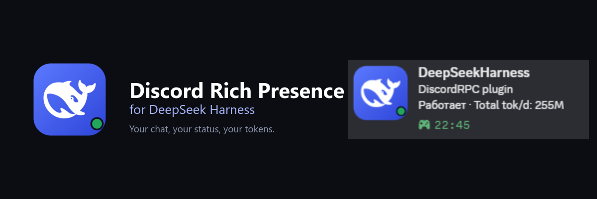
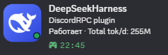

<p align="center">
  
</p>

<p align="center">
  <b>English</b> · <a href="README.ru.md">Русский</a> · <a href="README.zh.md">中文</a>
</p>

<p align="center">
  
  
  
</p>

# Discord Rich Presence for DeepSeek Harness

**Your chat, your status, your tokens — right in Discord.**

You know that moment when you look at your Discord profile and it still says
"Playing: nothing in particular"? This plugin fixes that small, silly thing.

While you work in DeepSeek Harness, your Discord card quietly shows the chat you
have open, whether the agent is working, how many tokens you have used today,
and a timer that starts with the turn. No commands, no copy-paste, no dashboards.



*The real card, captured from Discord. The screenshot is in Russian; the plugin
also speaks English and Chinese.*

## What you get

- **The chat you are actually in.** Switch tabs and the card follows you.
- **A living status.** `Working` while the agent is running, `Idle` when it is
  waiting for you.
- **Today at a glance.** `Total tok/d` is the token total for today, not a
  lifetime number that never changes.
- **A timer with a point.** It starts when the work starts, so the card shows
  how long the current turn has been going.
- **Zero setup by default.** A shared Application ID is already filled in. The
  card works as soon as the plugin is installed.
- **No extra plugin.** Token counts come from DSH's built-in token meter. If it
  is unavailable, the plugin reads the session log directly.
- **Three languages.** English, Russian, and Chinese for both the settings and
  the Discord card. English is the default.

## Install

1. Clone the repository:

   ```powershell
   git clone https://github.com/MakotoNikki/dsh-discord-rich.git
   ```

2. In DSH Desktop, open **Plugins** and install the `dsh-discord-rich` folder as
   a bundle. If you prefer a package, run `npm pack` in the folder and install
   the resulting `.tgz`.
3. Restart DSH Desktop.
4. Keep Discord open. Any client with local Rich Presence IPC works: Stable,
   PTB, Canary, Vesktop, Equicord, and friends.

Open **Settings → Discord Rich Presence**. The status dot should turn green and
the preview should show your chat. That is it.

> The card already works with the shared Application ID. You do **not** need to
> create a Discord application just to try it.

## Make it yours

The name at the top of the Discord card is the name of the Discord application,
not something the plugin invents. The shared app is called **DeepSeekHarness**.
If you want your own name, avatar, or assets:

1. Open the [Discord Developer Portal](https://discord.com/developers/applications)
   and create an application.
2. Copy its **Application ID** from **General Information**. This is a public ID,
   not a token.
3. Paste it into **Settings → Discord Rich Presence** and press **Save**.
4. Restart Discord if the old name is still cached.

## Languages

The settings header has a small `RU / EN / CN` switch. It changes everything at
once: the settings page and the Discord card. The choice is saved in the plugin
config, and **EN** is used when nothing has been chosen yet.

| Language | Status | Tokens today | Hover text |
| --- | --- | --- | --- |
| English | `Working` / `Idle` | `Total tok/d: 255M` | `1.2M tokens in this chat` |
| Русский | `Работает` / `Ожидает` | `Токенов за день: 255M` | `1.2M токенов за чат` |
| 中文 | `工作中` / `空闲` | `今日 Token：255M` | `本聊天 1.2M token` |

## The hover detail

Discord can show a small tooltip when someone hovers over the large image. To
make it show the token count for the current chat:

1. In the Discord Developer Portal, open **Rich Presence → Art Assets**.
2. Upload `assets/icon-1024.png` with the key `dsh`.
3. In the plugin settings, open **Icon & tooltip** and set the asset key to
   `dsh`.
4. Leave the custom tooltip empty. The plugin will fill in the chat token count
   in the selected language.

If you use the shared app, the `dsh` asset may already be there. If hover does
nothing, a custom app with your own uploaded asset is the reliable option.

## Privacy

Everything is local.

- The plugin reads token counts from DSH's built-in session projection cache,
  or from the session log if that cache is unavailable.
- It talks to Discord over the local IPC pipe.
- It does not read, store, or send your Discord token.
- It does not make network requests.
- Only the activity text and the optional large-image key are sent to Discord.

## Troubleshooting

| What you see | What to try |
| --- | --- |
| Nothing appears in Discord | Make sure Discord is running, then restart DSH Desktop. Check that the status dot is green in the plugin settings. |
| The card says "DeepSeekHarness" | That is the shared app's name. Create your own Discord application to use a different name. |
| The status is stuck on "Connecting" | Click **Reconnect** in the settings. Make sure Discord's **Activity Privacy → Share your detected activities** is enabled. |
| Hover does nothing | Upload the icon as an Art Asset with the key `dsh` and set the same key in the plugin settings. |
| The chat title is wrong | Switch to another chat once, or wait for the 15-second refresh. The card follows the active tab, not the last message. |
| The old app name is still cached | Quit Discord completely and start it again. |

## How it works

The web part of the plugin sits in the session header and reports which chat is
open to the host. The host reads DSH's built-in session projection cache (or the
native session log if that cache is unavailable), builds the activity, and
sends it to Discord through the local IPC socket. No server, no account, no
cloud.

## For developers

```text
index.js          host: Discord IPC, usage cache, HTTP API
client.js         settings page, language switch, active-tab reporter
locale/           en / ru / zh plugin metadata
assets/           plugin icon and Discord Art Asset
test.mjs          activity and session-selection tests
```

```powershell
npm run check
npm test
```

## License and credit

MIT. See [LICENSE](LICENSE). The code is free to use, change, and share.

The icon uses the DeepSeek whale mark. DeepSeek and the whale logo belong to
DeepSeek; Discord belongs to Discord Inc. This is an unofficial community
plugin, not affiliated with or endorsed by either company.
