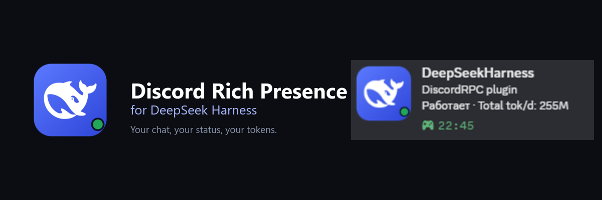
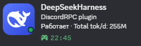

<p align="center">
  
</p>

<p align="center">
  <a href="README.md">English</a> · <b>Русский</b> · <a href="README.zh.md">中文</a>
</p>

<p align="center">
  
  
  
</p>

# Discord Rich Presence для DeepSeek Harness

**Твой чат, твой статус, твои токены — прямо в Discord.**

Бывает, открываешь свой профиль в Discord, а там всё ещё «Играет в: что-то
непонятное». Плагин исправляет эту маленькую несправедливость.

Пока ты работаешь в DeepSeek Harness, карточка в Discord тихо показывает
открытый чат, работает ли агент, сколько токенов ушло за сегодня и сколько
идёт текущий ход. Без команд, без копирования, без отдельных дашбордов.



*Настоящая карточка из Discord. Снимок сделан на русском; английский и
китайский включаются одной кнопкой.*

## Что получаешь

- **Тот чат, в котором ты действительно сидишь.** Переключил вкладку — карточка
  обновилась.
- **Живой статус.** `Работает`, пока агент выполняет ход, и `Ожидает`, когда он
  ждёт тебя.
- **Сегодняшние токены.** `Токенов за день` — это именно сегодняшний итог, а не
  вечная цифра, которая никогда не меняется.
- **Таймер по делу.** Он стартует вместе с работой и показывает, сколько уже
  идёт текущий ход.
- **Работает из коробки.** Общий Application ID уже подставлен: установил — и
  карточка появилась.
- **Без лишних плагинов.** Токены берутся из встроенного token-meter DSH. Если
  его нет, плагин читает лог сессии сам.
- **Три языка.** Английский, русский и китайский — и для настроек, и для
  карточки. По умолчанию английский.

## Установка

1. Склонируй репозиторий:

   ```powershell
   git clone https://github.com/MakotoNikki/dsh-discord-rich.git
   ```

2. В DSH Desktop открой **Plugins** и установи папку `dsh-discord-rich` как
   bundle. Если удобнее пакет — выполни `npm pack` в папке и установи
   получившийся `.tgz`.
3. Перезапусти DSH Desktop.
4. Оставь Discord открытым. Подойдёт любой клиент с локальным Rich Presence
   IPC: Stable, PTB, Canary, Vesktop, Equicord и компания.

Открой **Settings → Discord Rich Presence**. Точка статуса должна стать
зелёной, а в превью появится твой чат. Всё.

> С общим Application ID карточка работает сразу. Создавать своё приложение в
> Discord Developer Portal не обязательно, если хочется просто попробовать.

## Сделать под себя

Имя в верхней строке карточки — это название Discord-приложения, а не то, что
придумывает плагин. Общее приложение называется **DeepSeekHarness**. Если
хочется своё имя, аватар или ассеты:

1. Открой [Discord Developer Portal](https://discord.com/developers/applications)
   и создай приложение.
2. Скопируй **Application ID** со страницы **General Information**. Это
   публичный ID, а не токен.
3. Вставь его в **Settings → Discord Rich Presence** и нажми **Сохранить**.
4. Если Discord закешировал старое имя — полностью перезапусти его.

## Языки

В шапке настроек есть маленький переключатель `RU / EN / CN`. Он меняет всё
сразу: и страницу настроек, и карточку в Discord. Выбор сохраняется в конфиге,
а если ничего не выбрано — используется **EN**.

| Язык | Статус | Токены за день | Подсказка |
| --- | --- | --- | --- |
| English | `Working` / `Idle` | `Total tok/d: 255M` | `1.2M tokens in this chat` |
| Русский | `Работает` / `Ожидает` | `Токенов за день: 255M` | `1.2M токенов за чат` |
| 中文 | `工作中` / `空闲` | `今日 Token：255M` | `本聊天 1.2M token` |

## Подсказка при наведении

Discord умеет показывать маленькую подсказку, если навести курсор на большую
картинку. Чтобы там появились токены текущего чата:

1. В Discord Developer Portal открой **Rich Presence → Art Assets**.
2. Загрузи `assets/icon-1024.png` с ключом `dsh`.
3. В настройках плагина открой **Иконка и подсказка** и укажи ключ `dsh`.
4. Поле **Своя подсказка** оставь пустым — плагин сам подставит число токенов
   чата на выбранном языке.

Если используешь общее приложение, ассет `dsh` может уже быть на месте. Если
подсказка не появляется — надёжнее создать своё приложение и загрузить ассет
туда.

## Приватность

Всё локально.

- Плагин читает токены из встроенного кеша проекций DSH, а если его нет — из
  лога сессии.
- С Discord он общается через локальный IPC-канал.
- Он не читает, не хранит и не отправляет твой Discord-токен.
- Он не делает сетевых запросов.
- В Discord уходят только текст активности и, если включено, ключ картинки.

## Если что-то не так

| Что видишь | Что попробовать |
| --- | --- |
| В Discord ничего нет | Проверь, что Discord запущен, и перезапусти DSH Desktop. Точка статуса в настройках должна быть зелёной. |
| Карточка называется «DeepSeekHarness» | Это имя общего приложения. Создай своё приложение в Discord Developer Portal, чтобы поменять имя. |
| Статус висит на «Подключение» | Нажми **Переподключить** в настройках. Проверь, что в Discord включено **Activity Privacy → Share your detected activities**. |
| Подсказка не появляется | Загрузи иконку в Art Assets с ключом `dsh` и укажи тот же ключ в настройках плагина. |
| Неверное название чата | Переключись на другой чат один раз или подожди 15 секунд. Карточка следует за активной вкладкой, а не за последним сообщением. |
| Старое имя приложения не меняется | Полностью закрой Discord и запусти снова. |

## Как это устроено

Веб-часть плагина сидит в заголовке сессии и сообщает хосту, какой чат открыт.
Хост читает встроенный кеш проекций DSH (а если его нет — нативный лог сессии),
собирает активность и отправляет её в Discord через локальный IPC. Никакого
сервера, аккаунта или облака.

## Для разработчиков

```text
index.js          хост: Discord IPC, кеш usage, HTTP API
client.js         настройки, переключатель языков, репортер активной вкладки
locale/           метаданные плагина en / ru / zh
assets/           иконка плагина и арт для Discord
test.mjs          тесты активности и выбора сессии
```

```powershell
npm run check
npm test
```

## Лицензия и благодарности

MIT. См. [LICENSE](LICENSE). Код можно свободно использовать, менять и
распространять.

Иконка использует кита DeepSeek. DeepSeek и логотип-кит принадлежат DeepSeek;
Discord — Discord Inc. Это неофициальный community-плагин, не связанный с
обеими компаниями и не одобренный ими.
