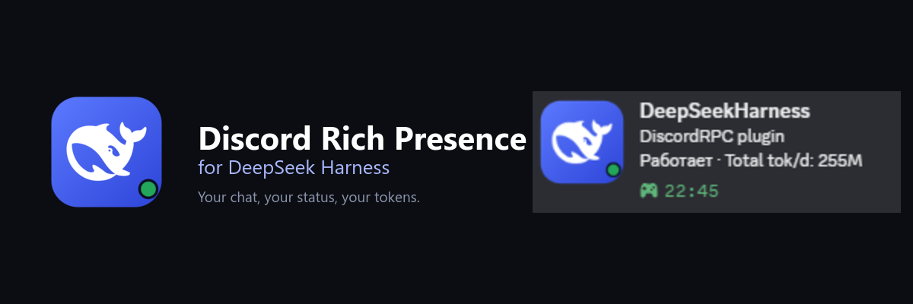
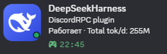

<p align="center">
  
</p>

<p align="center">
  <a href="README.md">English</a> · <a href="README.ru.md">Русский</a> · <b>中文</b>
</p>

<p align="center">
  
  
  
</p>

# DeepSeek Harness 的 Discord Rich Presence

**你的聊天、状态和 Token，直接显示在 Discord 里。**

你有没有过这种时刻：打开自己的 Discord 资料，发现上面还写着「正在玩：某个
说不清楚的东西」？这个小插件就是来修好这件小事的。

当你在 DeepSeek Harness 里工作时，Discord 卡片会安静地显示当前打开的聊天、
Agent 是否正在工作、今天已经用了多少 Token，以及本轮工作已经进行了多久。
不用命令，不用复制粘贴，也不用另开一个面板。



*这是从 Discord 里截下来的真实卡片。截图是俄语；英语和中文点一下就能切换。*

## 你会看到

- **你真正打开的那个聊天。** 切换标签页，卡片马上跟着换。
- **会动的状态。** Agent 跑回合时显示 `Working`，等你输入时显示 `Idle`。
- **今天的用量。** `Total tok/d` 是今天的 Token 总数，不是永远不动的累计值。
- **有意义的计时器。** 工作开始时计时，卡片会显示当前回合已经跑了多久。
- **开箱即用。** 已经预填共享 Application ID，装好插件就能看到卡片。
- **不需要额外插件。** Token 数来自 DSH 内置 token meter；如果它不可用，插件
  会直接读取会话日志。
- **三种语言。** 设置页和 Discord 卡片都支持英语、俄语和中文；默认英语。

## 安装

1. 克隆仓库：

   ```powershell
   git clone https://github.com/MakotoNikki/dsh-discord-rich.git
   ```

2. 打开 DSH Desktop，进入 **Plugins**，把 `dsh-discord-rich` 文件夹作为
   bundle 安装。更喜欢安装包的话，在文件夹里运行 `npm pack`，再安装生成的
   `.tgz`。
3. 重启 DSH Desktop。
4. 保持 Discord 运行。任何支持本地 Rich Presence IPC 的客户端都可以：
   Stable、PTB、Canary、Vesktop、Equicord 等等。

打开 **Settings → Discord Rich Presence**。状态圆点变绿、预览里出现你的聊天，
就说明成功了。

> 使用共享 Application ID 时，卡片已经能直接工作。只是想试试的话，不需要去
> Discord Developer Portal 创建应用。

## 换成你自己的

卡片最上方的名字来自 Discord 应用名称，不是插件随便起的。共享应用叫
**DeepSeekHarness**。如果你想要自己的名字、头像或素材：

1. 打开 [Discord Developer Portal](https://discord.com/developers/applications)，
   创建一个应用。
2. 在 **General Information** 里复制 **Application ID**。这是公开 ID，不是
   Token。
3. 粘贴到 **Settings → Discord Rich Presence**，点 **保存**。
4. 如果 Discord 还缓存着旧名字，完全退出再重新打开。

## 语言

设置页右上角有一个小小的 `RU / EN / CN` 开关。它会同时切换设置页和 Discord
卡片，选择会保存到插件配置里。没有选择过时使用 **EN**。

| 语言 | 状态 | 今日 Token | 悬停提示 |
| --- | --- | --- | --- |
| English | `Working` / `Idle` | `Total tok/d: 255M` | `1.2M tokens in this chat` |
| Русский | `Работает` / `Ожидает` | `Токенов за день: 255M` | `1.2M токенов за чат` |
| 中文 | `工作中` / `空闲` | `今日 Token：255M` | `本聊天 1.2M token` |

## 悬停小提示

Discord 支持在鼠标悬停到大图上时显示一小段提示。想让这里显示当前聊天的
Token 数：

1. 在 Discord Developer Portal 打开 **Rich Presence → Art Assets**。
2. 上传 `assets/icon-1024.png`，key 填 `dsh`。
3. 在插件设置里打开 **图标与悬停提示**，把 asset key 也填成 `dsh`。
4. **自定义提示**留空。插件会自动填入当前聊天的 Token 数，并使用你选择的
   语言。

如果你用的是共享应用，`dsh` 素材可能已经存在。如果悬停没有反应，最稳妥的
办法是创建自己的应用并上传素材。

## 隐私

一切都在本地完成。

- 插件从 DSH 内置的会话投影缓存读取 Token 数；缓存不可用时直接读取会话日志。
- 它通过本地 IPC 管道和 Discord 通信。
- 它不会读取、保存或发送你的 Discord Token。
- 它不会发起网络请求。
- 只有活动文字和可选的图片 key 会发送给 Discord。

## 遇到问题

| 现象 | 可以试试 |
| --- | --- |
| Discord 里什么都没有 | 确认 Discord 正在运行，然后重启 DSH Desktop。设置里的状态圆点应该是绿色。 |
| 卡片名字是「DeepSeekHarness」 | 这是共享应用的名称。创建自己的 Discord 应用就能换名字。 |
| 状态一直停在「正在连接」 | 点设置里的 **重新连接**。确认 Discord 的 **Activity Privacy → Share your detected activities** 已开启。 |
| 悬停没有提示 | 在 Art Assets 里上传图标，key 填 `dsh`，并在插件设置里填同一个 key。 |
| 聊天标题不对 | 切到另一个聊天一次，或等 15 秒刷新。卡片跟随当前标签页，而不是最后一条消息。 |
| 旧应用名一直不更新 | 完全退出 Discord，再重新启动。 |

## 工作原理

插件的网页部分挂在会话标题栏里，把当前打开的聊天告诉 Host。Host 读取 DSH
内置的会话投影缓存（缓存不可用时直接读会话日志），拼出 Activity，再通过本地
IPC 发给 Discord。没有服务器，没有账号，也没有云端。

## 给开发者

```text
index.js          Host：Discord IPC、usage 缓存、HTTP API
client.js         设置页、语言开关、活动标签页上报
locale/           插件元数据 en / ru / zh
assets/           插件图标和 Discord Art Asset
test.mjs          Activity 和会话选择测试
```

```powershell
npm run check
npm test
```

## 许可证与说明

MIT，见 [LICENSE](LICENSE)。代码可以自由使用、修改和分享。

图标使用了 DeepSeek 的鲸鱼标志。DeepSeek 和鲸鱼标志归 DeepSeek 所有；
Discord 归 Discord Inc. 所有。这是一个非官方社区插件，与两家公司均无关联，
也未获得它们的背书。
